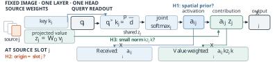

# High Attention, Low Contribution: A Fast-Weight Diagnosis of ViT Attention Maps

**Hongbo Huang** | DSAA 2012 Deep Learning | HKUST(GZ)

[Read the paper (PDF)](paper/High_Attention_Low_Contribution_A_Fast_Weight_Diagnosis_of_ViT_Attention_Maps.pdf) | [LaTeX source](paper/main.tex) | [Original registration](docs/preregistration.md) | [Experiments](experiments/README.md)

Deep-layer attention maps of vision transformers (ViTs) often highlight uninformative background patches rather than objects. Viewing each fixed-image head as a two-layer fast-weight network (attention weights as hidden activations, projected values as output weights) shows that these peaks arise because standard maps omit the second layer, unifying positional bias (H1), token mixing (H2) and low-norm value outputs (H3) under one matched-control evaluation on frozen models:

- **Only projected value weighting (H3) outperforms both received attention and its matched control:** weighting attention by each patch's projected value norm raises foreground enrichment by **0.038–0.065** and ClickMe alignment by **0.033–0.058** in supervised DeiTs (closing **43–59%** of the alignment gap to 12-layer gradient attribution GAE), outperforms `>3x` outlier zeroing on three of four supervised alignment tests, and leaves the artifact-free DINO ViT-S control unchanged ($\le 0.004$). Mean-map subtraction fails against Gaussian bias controls, and attention relocation degrades alignment whether routed by linear position probes or perturbation-based input-patch masking (`experiments/feature_origin/`).
- **The mechanism suppresses a graded low-output tail and generalises across pretraining regimes:** on 383 Oxford-IIIT Pet crops (`experiments/decomposition/`), weighting only non-outlier patches after zeroing `>3x` outliers adds **~94%** as much enrichment gain as full value weighting and within-ring non-outlier norm shuffling eliminates it, while lowering the binary threshold to `1.5x` flags a broader tail attracting **48–63%** of layer-12 attention. The same effect holds in self-supervised DINOv2 and multimodal CLIP ViT-B/16 and disappears spatially in matched register-trained DINOv2+reg4 backbones (`experiments/registers/`).
- **Patch deletion defines the readout's scope:** value weighting restores visual alignment rather than classifier deletion faithfulness (top-1 deletion gains stay below `0.05`), and restricting pooling to the classification token (`CLS`) shifts both foreground AUROC (**−0.091** vs. **+0.024**) and post-embedding patch-token deletion in opposite directions across DeiT-S and DeiT-B (`experiments/cls_deletion/`, [replication](experiments/receiver_review/README.md)).



For the norm-placement controls in Appendix E (Table E.1), keeping projected norms at their native patches yields enrichment **0.160**, compared with **0.137** for donor-image ordering and **0.138** for same-radius shuffling. See the [saved scores](experiments/spatial/summary.json) and [implementation](experiments/spatial/run_spatial.py).

## Set up

Clone the repository. The saved-results workflow uses Python 3.12, CPU PyTorch and no external dataset. Start the following commands at the repository root:

```bash
git clone https://github.com/hhuang999/DSAA2012-vit-fastweight.git
cd DSAA2012-vit-fastweight
python -m venv .venv
source .venv/bin/activate
python -m pip install -r requirements-torch.txt --index-url https://download.pytorch.org/whl/cpu
python -m pip install -r requirements.txt
python -m pip install -e . --no-deps
```

For a checked-out manuscript alone, install Tectonic and run `tectonic -X compile main.tex` from `paper/`. No Python or image datasets are needed for this route.

On Windows activate with `.venv\Scripts\Activate.ps1`. For GPU inference use a separate environment, installing the compatible CUDA wheels for the torch/torchvision pair before the remaining requirements. Model revisions, transforms and download locations live in [the model loaders](src/fastweight_vit/models/) and [dataset loaders](src/fastweight_vit/data/).

**Minimal example.** Recover the central Table 1 contrast from per-image scores, before bootstrapping or rounding:

```bash
python -c "import pandas as pd; t=pd.read_csv('experiments/cls/three_endpoint_per_image.csv').set_index(['method','image']); print((t.loc['cls_sum_head']-t.loc['all_c3']).mean().round(3))"
```

Expected values are `0.041` for margin Spearman, `-0.033` for same-ring enrichment and `-0.091` for AUROC.

## Rebuild the paper from saved results

```bash
python -m pytest -q
python scripts/validate_research.py --strict
python scripts/rebuild_results.py --destination build/rebuilt
python -m experiments.receiver_review.audit
python experiments/audit_v22.py
python scripts/display/build.py
python scripts/build_paper.py
```

On Windows with a long system temp path, set `TEMP` and `TMP` to a short writable directory before running the tests.

The numerical rebuild starts from the preserved per-image and per-layer exports in [outputs](outputs/) and compares regenerated summaries with [results](results/). Use a fresh destination for each numerical rebuild. The display builder uses the released evidence to regenerate the figures and tables included by LaTeX. The final command needs [Tectonic](https://tectonic-typesetting.github.io/en-US/) on PATH. It verifies the bundled NeurIPS style and writes `build/paper/High_Attention_Low_Contribution_A_Fast_Weight_Diagnosis_of_ViT_Attention_Maps.pdf`. To compile the exact release figures, run the typesetting command directly on a fresh checkout. Font availability can affect regenerated plots.

| Paper item | Source evidence or implementation | Rebuilt output |
| --- | --- | --- |
| Fig. 1, fixed-seed teaser example | `scripts/display/build_static_figures.py` (`teaser_maps`) from `outputs/table1/clickme/deit/` | `paper/figures/teaser_maps.pdf` |
| Fig. 2, one image-conditioned head | `scripts/display/build_static_figures.py` (`fast_weight_lens`) and `paper/figures/fast_weight_lens.svg` | `paper/figures/fast_weight_lens.pdf` |
| Fig. 3, diagnostics and alignment effects | `results/correct_tests.csv`; diagnostics from `results/diagnose.csv`; deletion contrasts in Appendix B | `paper/figures/diagnosis_correction_bridge.pdf` |
| Fig. 4, mechanism ablations and cross-paradigm controls | `scripts/display/build_v22_displays.py` from `experiments/{decomposition,registers}/` | `paper/figures/mechanism_and_registers.pdf` |
| Table 1, CLS vs all-query contrasts | `experiments/{cls,receiver_review/deit_b}/three_endpoint_contrasts.csv` | `paper/tables/cls_compact.tex`; full table in `cls_full.tex` |
| Tables B.4–B.5, C.1, E.3: decomposition, registers, masking dependence & patch-token deletion | `scripts/display/build_v22_displays.py` from `experiments/{decomposition,registers,feature_origin,cls_deletion}/` | `paper/tables/v22_{decomposition,registers,feature_origin,cls_deletion}.tex` |
| Table A.1, original registered predictions | P1–P7 in `docs/preregistration.md` and preserved verdicts in `results/`, checked by `validate_research.py` | Interpretation and archive-label mapping in `paper/appendix.tex` |
| Table A.2, Fig. A.1, setup and metric schematic | `scripts/display/build_appendix_figures.py` (`metrics_schematic`) | `paper/figures/metric_schematic.pdf` |
| Fig. B.1, execution agreement | `results/k_sweep.csv` | `paper/figures/execution_k_sweep.pdf` |
| Figs. B.2, C.1, norm recovery and probe errors | `scripts/display/build_appendix_figures.py` from `results/` | `paper/figures/{value_norm_recovery,probe_errors}.pdf` |
| Tables B.1–B.3, B.6, scores, diagnostics, contrasts and sanity check | Registered summaries, paired differences and parameter-randomisation results | `paper/tables/{registered_main,diagnostics_per_layer,registered_paired,registered_sanity}.tex` |
| Table C.2, probe-relocation alternatives | `results/c2_analysis/` and `results/supplementary/` | `paper/tables/relocation_explanations.tex` |
| Figs. D.1–D.2, fixed example maps | Gallery tensors in `outputs/table1/clickme/deit/`, [fixed indices](data/splits/gallery_selection.json) | `paper/figures/example_maps{,_more}.pdf` |
| Tables B.7–B.8, Fig. B.3, endpoint and geometry checks | `experiments/endpoints/`, `experiments/geometry/`, `experiments/endpoints/plot_curves.py` | `paper/tables/{endpoint,geometry}.tex`, `paper/figures/deletion_curves.pdf` and [docs copy](docs/figures/deletion_curves.pdf) |

Tables E.1–E.3 give the spatial norm-placement controls, block-12 CLS intervention scores behind Table 1, and layer-12 post-embedding patch-token deletion results. In the archived scores, R0 is received attention; C1, C2 and C3 denote mean subtraction, probe relocation and value weighting. R_all combines the three.

Run `python scripts/display/build.py` for the generated items in the table and `python scripts/build_paper.py` to typeset them, including the registration table and key code. The [registered experiment guide](docs/reproduce.md) traces the numerical results to their producing configurations. The [exploratory guide](experiments/README.md) gives the commands for regenerating Oxford readouts, geometry, deletion endpoints and paired uncertainty estimates.

## Run from images and model weights

Use a CUDA environment for the full inference experiments. The [runner](scripts/run.py) dispatches the [registered configurations](configs/) to the [implementations](src/fastweight_vit/experiments/); [readings.py](src/fastweight_vit/readings.py) implements the maps. The original study uses supervised DeiT-S/B and DINO ViT-S/16 (with the authors' linear head). Evaluation uses 224-pixel inputs and 16-pixel patches. DeiT resizes the short side to 248 and takes a centre crop; DINO uses 256. ClickMe follows the released heatmap geometry and resizes the image without cropping. Keep the fixed splits and ClickMe batch size of 64: the other-image control pairs each human map with the preceding image inside its batch.

1. For ImageNet-1k, obtain access to the pinned Hugging Face dataset and make a read token available as `HF_TOKEN`. ImageNet-S masks and ClickMe validation shards are downloaded by the dataset preparation script. Fetch weights with the model downloader; MiTA uses the authors' released checkpoint.
2. From the repository root, run:

   ```bash
   python -m pip install -r requirements-download.txt
   python scripts/prepare_data.py imagenet imagenet_s clickme
   python scripts/prepare_data.py --check
   python scripts/download_models.py
   python scripts/run.py --config configs/k_sweep.yaml --output outputs/rerun
   ```

   For the complete sequence of configurations, including calibration and probe fitting, run `bash reproduce/full.sh outputs/rerun build/gpu-results` (Bash, Git Bash or WSL). Each new run writes separate outputs. The historical run ID `table1` identifies the registered readout comparison in the archive and configurations. Its scores feed Figure 3 and Appendix B. The original numerical thresholds and directional predictions are recorded in [the registration](docs/preregistration.md).
3. For the Oxford cases, follow the [Oxford download and setup commands](experiments/README.md). Use the public pet images and trimaps and pinned DeiT-S weights; the receiver replication also uses DeiT-B. After setup:

   ```bash
   python -m experiments.spatial.run_spatial --output-dir outputs/rerun/spatial
   python -m experiments.spatial.audit_results --input-dir outputs/rerun/spatial --output-dir outputs/rerun/spatial
   python -m experiments.cls.run_cls --output-dir outputs/rerun/cls
   python -m experiments.cls.analyze_endpoints --input-dir outputs/rerun/cls --output-dir outputs/rerun/cls
   ```

For the [DeiT-B replication and paired audit](experiments/receiver_review/README.md), use the same images and the base checkpoint. The supplementary decomposition, register-trained DINOv2 / CLIP, input-patch masking dependence, and layer-12 CLS patch-token deletion studies live in `experiments/{decomposition,registers,feature_origin,cls_deletion}/`, documented in [the exploratory guide](experiments/README.md) and verified on CPU by `python experiments/audit_v22.py`.

The Oxford studies are exploratory. The protocol records which comparisons were specified before scoring and which mask analysis followed inspection of the CLS margin results. Source-image IDs and historical literal hash prefixes are preserved so renaming a study directory cannot change its sample.

Code is distributed under the [MIT license](LICENSE). External images, human maps, pretrained weights and the conference template retain their original terms. Citation information is in [CITATION.cff](CITATION.cff).
